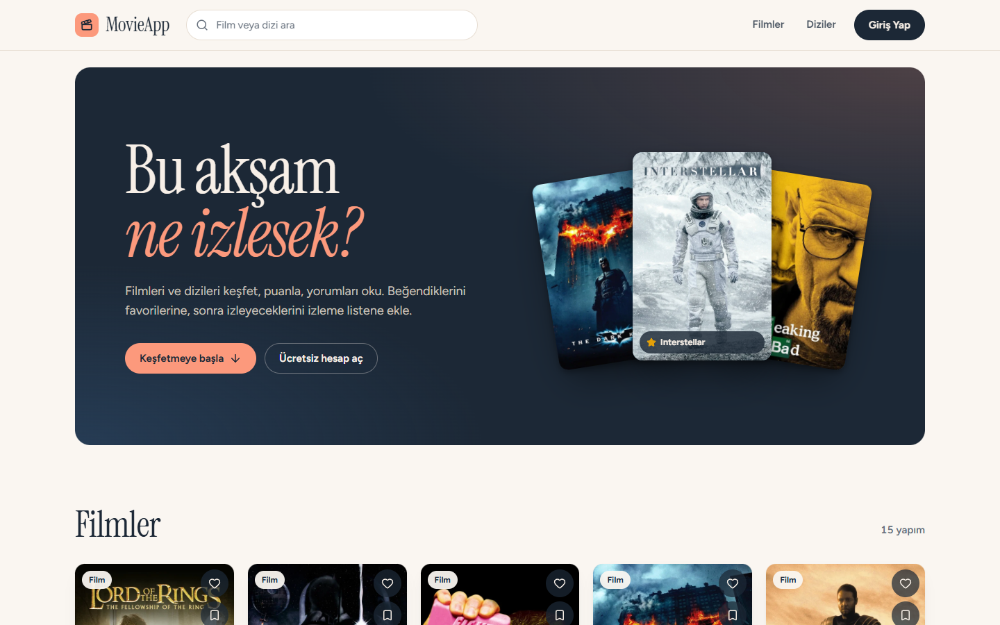
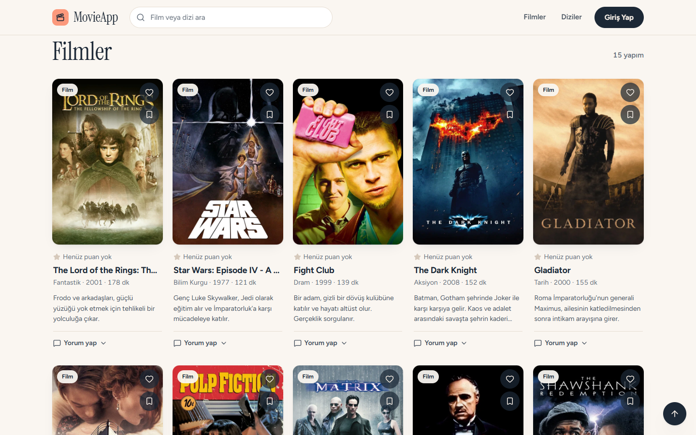
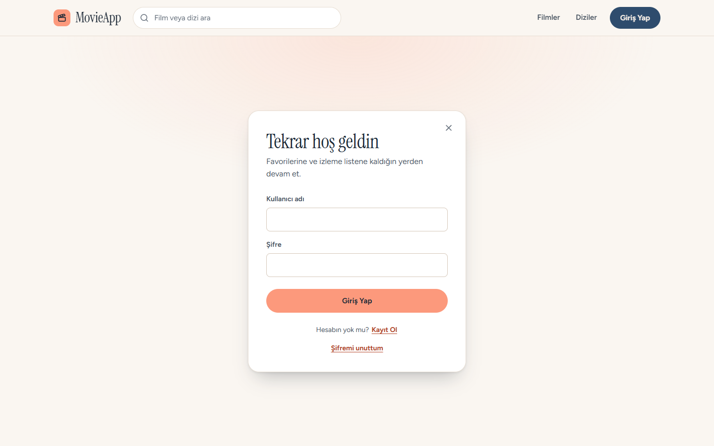
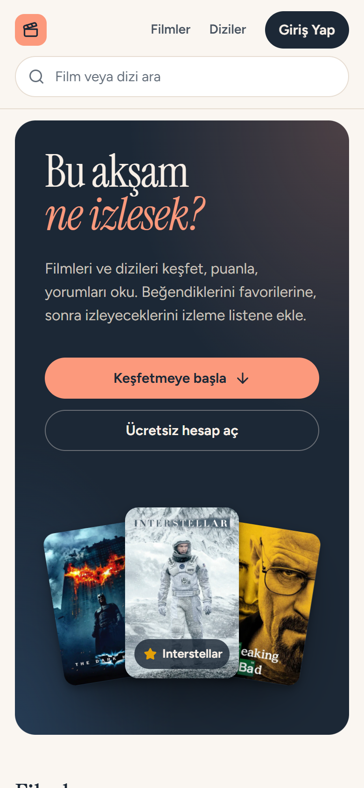

#  MovieApp: Full-Stack Content Platform

**Live demo: [movieapp-ye06.onrender.com](https://movieapp-ye06.onrender.com)**

> ⏳ **First visit may be slow:** the app runs on a free plan, so the server sleeps after 15 minutes without visitors. The first request can take up to a minute while it wakes up. This is normal, so please wait instead of refreshing.

MovieApp is a modern, end-to-end content management platform where users can discover, rate, and manage movies and TV series. The project is built following **Layered Architecture** and **Object-Oriented Programming (OOP)** principles, ensuring industrial standards for code quality, scalability, and maintainability.

## Screenshots





<p align="center">
  
  &nbsp;
  
</p>

## Key Features

**For users**
*   **Discover:** Browse movies and TV series as poster cards with genre, year, runtime / season count and community rating; filter by *Movies* or *Series*.
*   **Live search:** Search by title as you type (debounced, out-of-order responses ignored).
*   **Favorites & Watchlist:** Add or remove titles with one tap on the poster; manage both lists from the *My Account* page.
*   **Ratings & reviews:** Rate titles with 1–5 stars and write comments; averages are shown on a 10-point scale. Users can delete their own reviews.
*   **Accounts:** Sign up and log in with JWT; a **welcome email** is sent after registration.
*   **Password reset by email:** One-time, 15-minute reset link; the response never reveals whether an email is registered.
*   **Responsive design:** Custom design system (cream / coral / navy, Instrument Serif + Figtree) that works on phone, tablet and desktop, with skeleton loading, empty and error states, keyboard focus styles and accessible star rating.
*   **Privacy page:** Explains what data is stored and why (KVKK), plus TMDB attribution.

**For admins**
*   **Content dashboard:** Add, edit and delete movies and series from a table + form admin panel.
*   **Moderation:** Admins can delete any review.
*   **Role-based access:** `USER` / `ADMIN` roles enforced on the server with Spring Security (`@PreAuthorize`).

**Under the hood**
*   **Polymorphic data model:** JPA *Joined Inheritance* for `Movie` and `Series`, both extending a base `Content` entity.
*   **Security:** BCrypt password hashing, JWT with session revocation on password change, per-IP rate limiting on login / register / password reset, strict CORS, Content-Security-Policy and HSTS headers, generic error responses that never leak internals.
*   **Tests:** 20 backend tests (integration tests for the main attack paths + unit tests), run on an in-memory database.
*   **Automatic seed data:** Popular titles are inserted on first start.
*   **One-image deployment:** The React build is served by the Spring Boot jar from a single Docker image.

## Tech Stack

*   **Backend:** Java 17, Spring Boot 3, Spring Security, JWT, Spring Data JPA, Hibernate
*   **Frontend:** React, Vite, CSS (responsive, custom design system), Lucide icons
*   **Database:** PostgreSQL ([Neon](https://neon.com)) in production, MySQL or H2 locally
*   **Hosting:** [Render](https://render.com) (Docker), transactional email via [Brevo](https://www.brevo.com)
*   **Tools & Build:** Maven, npm, Docker, Git

---

## How to Run Locally

### 1. Database
Create the database and a user in your local MySQL instance:

```sql
CREATE DATABASE movieapp;
CREATE USER 'movieapp_user'@'localhost' IDENTIFIED BY 'your-password';
GRANT ALL PRIVILEGES ON movieapp.* TO 'movieapp_user'@'localhost';
```

### 2. Configuration
All secrets are read from environment variables — never write them into `application.properties`.
Copy `.env.example` and fill in the values (see the comments in the file):

| Variable | Required | Description |
|----------|----------|-------------|
| `DB_PASSWORD` | yes | MySQL password |
| `JWT_SECRET` | yes (production) | At least 32 random characters: `openssl rand -base64 48`. If missing, a temporary key is generated and everyone is logged out on restart. |
| `MAIL_USERNAME`, `MAIL_PASSWORD`, `MAIL_FROM` | for emails | Gmail address and an App Password (or set `BREVO_API_KEY` to send through Brevo) |
| `CORS_ALLOWED_ORIGINS` | production | Frontend URL, e.g. `https://example.com` |
| `FRONTEND_RESET_PASSWORD_URL` | production | e.g. `https://example.com/reset-password` |

### 3. Backend
```bash
cd backend
mvn spring-boot:run
```

### 4. Frontend
```bash
cd frontend
npm install
npm run dev
```
The app runs at http://localhost:5173 (API calls are proxied to the backend on port 8080).

### 5. Admin account
Register a normal account in the app, then promote it in the database:

```sql
UPDATE users SET role = 'ADMIN' WHERE username = 'your-username';
```

> `db-seed-users-with-email.sql` creates an `admin` / `123456` account — local development only, never run it on a production database.

## Tests

```bash
cd backend && mvn test     # 20 tests on an in-memory H2 database (no MySQL needed)
cd frontend && npm run lint
```

## Deployment

The live demo runs on **Render + Neon + Brevo**, all on free plans. Step-by-step guide (in Turkish): [`DEPLOY.md`](DEPLOY.md).
Every push to `main` is deployed automatically.
The [`Dockerfile`](Dockerfile) builds the frontend and serves it from the Spring Boot jar, so the whole app is a single service; [`render.yaml`](render.yaml) sets it up on Render.

**Own server:** build the image with `docker build -t movieapp .`, or run Nginx in front of the jar — see [`deploy/nginx.conf`](deploy/nginx.conf). Enable HTTPS (e.g. `certbot --nginx`).

Login, registration and password reset are rate limited per IP. Changing a password logs out all existing sessions.
